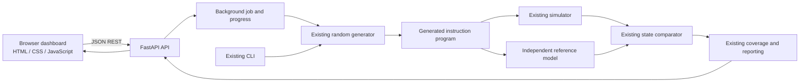

# RISC-V Processor Verification Toolkit

A Python differential verification engine with a local web dashboard for a defined RV32I subset. The CLI and FastAPI application both use the existing verification runner. The dashboard displays actual generated runs, per-test results, architectural state, coverage, replay output, and JSON reports from that engine.

> This project implements a defined subset of RV32I for educational verification purposes. It is not a complete RISC-V implementation and does not claim exhaustive processor verification or formal verification.

## Features

- Procedural RV32I subset simulator and independently implemented reference model.
- Seeded constrained-random program generation and deterministic test replay.
- Register, PC, and memory comparison with structured mismatches.
- Instruction mnemonic, category, register, and memory access coverage.
- Existing command-line interface and JSON reporting.
- FastAPI REST API with bounded background jobs and actual per-test progress.
- Responsive dark dashboard built with HTML5, CSS3, and vanilla JavaScript.
- No database, frontend build step, or browser charting dependency.

## Supported instructions and architecture model

| Category | Instructions |
|---|---|
| R-Type | ADD, SUB, AND, OR, XOR, SLT |
| I-Type | ADDI, ANDI, ORI, XORI, SLTI |
| Memory | LW, SW |
| Branches | BEQ, BNE |
| Upper Immediate | LUI, AUIPC |
| Jumps | JAL, JALR |

Registers and results are 32-bit; x0 always reads zero and ignores writes. Memory is byte-addressable, little-endian, and supports aligned in-range word accesses. Randomly generated control flow is limited to a forward branch or jump at the first instruction so programs have bounded execution.



The API does not replace or reimplement instruction behavior. `POST /api/run` calls `VerificationRunner.run_one()` for each test. `POST /api/replay` calls the runner's existing `replay()` method. To show a selected test's register, PC, and memory state, the API reruns its retained instruction program through the existing simulator and reference model.

## Technology

- Python 3.10
- FastAPI and Uvicorn
- Pydantic request validation
- HTML5, CSS3, and vanilla JavaScript modules
- pytest and HTTPX for tests
- Python standard library for the verification engine

## Installation

From this directory, on Windows PowerShell:

```powershell
python -m venv .venv
.\.venv\Scripts\Activate.ps1
python -m pip install -r requirements.txt
python -m pip install -e .
```

On Linux/macOS:

```shell
python3 -m venv .venv
source .venv/bin/activate
python -m pip install -r requirements.txt
python -m pip install -e .
```

## Start the web application

Activate the environment, then run:

```shell
python -m uvicorn riscv_verify.api.main:app --reload --host 127.0.0.1 --port 8000
```

Open **http://127.0.0.1:8000/**. FastAPI serves the static dashboard and API on the same origin. Local static-server CORS origins are explicitly limited to `http://127.0.0.1:5500` and `http://localhost:5500`; no wildcard origin is enabled. OpenAPI documentation is available at `/docs`.

The Run Verification form accepts 1–10,000 tests, a reproducible optional seed, length bounds, and coverage-guided mode. It displays job status and progress as each generated program completes. The test table is paginated and filterable. Selecting a result displays the program, structured mismatch data, expected/actual registers and PC, and nonzero memory words. The replay form calls the existing replay implementation. The report page previews and downloads the latest backend-generated JSON report.

Only one API campaign runs at a time. Job and test history is held in memory and is reset when the server restarts. The generated JSON report is written under `reports/` and is available for download while the process is running.

## Existing CLI

The web layer leaves the CLI intact:

```shell
python -m riscv_verify --help
python -m riscv_verify run --tests 10 --seed 42
python -m riscv_verify run --tests 10000 --seed 42 --coverage-guided
python -m riscv_verify coverage
python -m riscv_verify replay --seed 42 --test-id 100 --coverage-guided
```

## REST API

| Method and path | Purpose |
|---|---|
| `GET /api/health` | API readiness and engine identity |
| `GET /api/summary` | Latest run totals, timestamp, and current progress |
| `POST /api/run` | Start an asynchronous verification job; returns a job ID |
| `GET /api/jobs/{job_id}` | Poll real status and completed-test progress |
| `GET /api/results?offset=0&limit=50&status=all` | Paginated real test rows; status can be `PASS` or `FAIL` |
| `GET /api/results/{test_id}` | Re-execute a retained program and return state/mismatch details |
| `GET /api/coverage` | Latest run's mnemonic, category, and memory coverage |
| `POST /api/replay` | Replay from seed and one-based test ID |
| `GET /api/instructions` | Supported mnemonics, categories, and descriptions |
| `GET /api/report` | Latest run's timestamp and machine-readable summary |
| `GET /api/report/download` | Download the JSON report created by the existing report writer |

Example run request:

```json
{
  "tests": 100,
  "seed": 42,
  "coverage_guided": true,
  "min_length": 8,
  "max_length": 32
}
```

Input is validated by Pydantic. Test count, seed, test ID, memory size, and program lengths are bounded. Invalid inputs return structured JSON errors. Server stack traces and local filesystem paths are not returned to the browser.

## Dashboard pages

- **Dashboard:** API-derived run totals, pass/fail chart, mnemonic coverage, recent results, and per-test executed-instruction chart.
- **Run verification:** starts the actual backend engine and polls job progress.
- **Coverage:** instruction occurrence counts, distinct mnemonic coverage, categories, and memory activity. Mnemonic coverage means “executed at least once”; it is not exhaustive verification.
- **Test results:** paginated/filterable test rows and architectural detail views.
- **Instruction set:** supported subset returned by the API.
- **Reports:** latest report preview and JSON download.
- **About:** project purpose and workflow.

Dashboard metrics are fetched from the API; the frontend contains no sample verification results. Charts use CSS and values returned by the backend.

## Tests and validation

```shell
pytest -q
```

The existing simulator and differential tests remain in place. `tests/test_api.py` checks the served frontend, endpoint validation, real run/progress/result/coverage/report flow, replay, architectural details, and structured mismatch rendering using a fault injected only in that test.

For a manual web workflow, start Uvicorn, open the dashboard URL, run a small campaign (for example 100 tests with seed 42), inspect coverage and a result, then replay a test using the same seed and test ID. The CLI remains useful for longer campaigns.


## Limitations

This is a local educational portfolio application. The job registry is in-memory, only one API run executes at a time, generated control flow is constrained, and final-state comparison can miss transient state divergence. The engine does not include binary instruction decoding, a pipeline, traps/CSRs/privilege modes, ELF loading, hardware execution, or an RTL co-simulation interface. Neither the dashboard nor instruction coverage constitutes exhaustive or formal verification.
